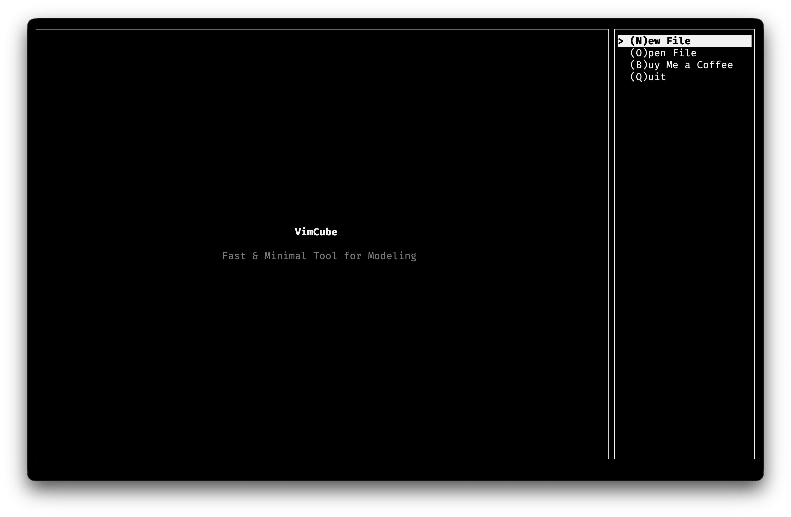

# VimCube - Work in Progress



**VimCube** is a lightweight, high-performance TUI 3D concept modeler with FTXUI for developers and power users who favor Vim-style modal editing. Designed specifically for terminal environments, it combines intuitive single-key navigation with a non-destructive procedural pipeline, allowing users to build, manipulate, and export 3D geometries via UNIX-inspired command sequences without relying on a mouse. By leveraging a genetic-code-based sequence pipeline, users can write concise text recipes to procedurally grow and mutate complex 3D shapes in real time. By leveraging CPU-based matrix transformations and rendering wireframes through high-resolution Braille Unicode characters, VimCube delivers a fast and fluid 3D modeling experience directly within your shell.


# Features


## Available

- Vim-style Key for Generating/Editing Geometries

- Vim-style Colon Commands for Utilities

- Normal / Command / Sequence / Focus Mode

- Braille Dot-based Rendering Engine

- JSON File I/O

## Planned

- More Basic Geometry Types

- Boolean Transformations

- Support various file formats(.obj, .ply)

## Example Codes

You can copy and paste these gene codes for test.

### Stacked Boxes
```text
c10w0.5zw2xr;c10w0.5zw2xr30zm5z;c10w0.5zw2xr60zm10z;c10w0.5zw2xr90zm15z;c10w0.5zw2xr120zm20z;c10w0.5zw2xr150zm25z;

```
### Puppy
```text
p20w0.5zm20zw0.5y;p7m5zm10xw0.5xw0.5ym5ym2z;p7m5zm10xw0.5xw0.5ym-5ym2z;p7m5zm10xw0.5xw0.5ym5ym-20xm2z;p7m5zm10xw0.5xw0.5ym-5ym-20xm2z;p10m25zm15x;p7m30zm15xw0.6xm7y;p7m30zm15xw0.6xm-7y;p7m20zm-20xw0.5zw0.5yr30ym5zw1.5x;
```
